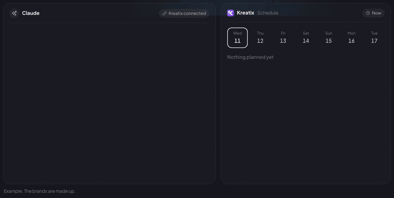

<p align="center"></p>

# Kreatix MCP server

Let your AI agent schedule posts to your Instagram, TikTok, YouTube, Facebook, X, LinkedIn and Pinterest pages, move or cancel them, and read your numbers.

[Kreatix](https://kreatix.cc) is a social media scheduler for people who run many pages: one video goes to every connected page at once, each with its own platform settings. This repository documents its hosted MCP server. There is nothing to install or run.

<p align="center"></p>
<p align="center"><sub>Example. The brands are made up. Live version: <a href="https://kreatix.cc/ai-agents/">kreatix.cc/ai-agents</a></sub></p>

| | |
|---|---|
| Address | `https://api.kreatix.cc/mcp` |
| Transport | Streamable HTTP, stateless |
| Auth | Sign in with Kreatix (OAuth 2.1 with PKCE; client ID metadata documents and dynamic registration), or your Kreatix agent key as `Authorization: Bearer kx_live_...` or inside the address: `https://api.kreatix.cc/mcp/kx_live_...` |
| MCP Registry | [`cc.kreatix/kreatix`](https://registry.modelcontextprotocol.io/v0/servers?search=cc.kreatix) |

## Sign in, no key

Most agents connect with the bare address and a sign-in: add `https://api.kreatix.cc/mcp`, the agent opens Kreatix, you sign in and press Allow.

- **Claude**: Customize > Connectors > Add > Add custom connector. Paste the address, Continue, Add, then Connect.
- **ChatGPT**: chatgpt.com/plugins > + > Add custom MCP server. Paste the address, choose OAuth, create the plugin and install it.
- **Grok**: grok.com/connectors > New Connector > Custom. Paste the address.
- **Claude Code**: `claude mcp add --transport http --scope user kreatix https://api.kreatix.cc/mcp`, then `/mcp` in claude.
- **Codex**: `codex mcp add kreatix --url https://api.kreatix.cc/mcp`, then `codex mcp login kreatix`.
- **Cursor**: `{"mcpServers": {"kreatix": {"url": "https://api.kreatix.cc/mcp"}}}` in `~/.cursor/mcp.json`, then sign in when Cursor asks.
- **OpenClaw**: `openclaw mcp add kreatix --url https://api.kreatix.cc/mcp --transport streamable-http --auth oauth`.

Each connected app gets a key named after it in Settings > AI agent; delete it there to cut the app off.

Step-by-step guides for each agent and platform: [kreatix.cc/ai-agents](https://kreatix.cc/ai-agents/), for example [Claude](https://kreatix.cc/ai-agents/claude/), [ChatGPT](https://kreatix.cc/ai-agents/chatgpt/), [Claude Code](https://kreatix.cc/ai-agents/claude-code/), [Cursor](https://kreatix.cc/ai-agents/cursor/), [Codex](https://kreatix.cc/ai-agents/codex/), [Grok](https://kreatix.cc/ai-agents/grok/) and [OpenClaw](https://kreatix.cc/ai-agents/openclaw/). In Turkish: [Claude](https://kreatix.cc/tr/yapay-zeka-ajani/claude/), [ChatGPT](https://kreatix.cc/tr/yapay-zeka-ajani/chatgpt/).

## Get a key

For apps without sign-in, or when you would rather paste a key:

1. Sign up at [kreatix.cc](https://kreatix.cc) and connect your pages.
2. Open Settings, then AI agent ([kreatix.cc/settings/agent](https://kreatix.cc/settings/agent)) and create a key. It is shown once.
3. Delete the key there at any time and it stops working at once.

Scheduling through an agent needs a paid plan or a running trial, the same as scheduling in the app. It costs nothing extra.

## Connect with a key

**Claude** (claude.ai and Claude Desktop): Customize > Connectors > Add > Add custom connector. Paste the address with your key, press Continue, choose No sign-in under Authentication, then Add:

```
https://api.kreatix.cc/mcp/YOUR_KEY
```

**ChatGPT**: open chatgpt.com/plugins, press + and choose Add custom MCP server. Paste the same address with your key, choose No authentication, then create and install the plugin.

**Grok**: open grok.com/connectors and choose New Connector, Custom. Paste the same address with your key.

**Claude Code**:

```bash
claude mcp add --transport http --scope user kreatix https://api.kreatix.cc/mcp --header "Authorization: Bearer YOUR_KEY"
```

**Cursor** (`~/.cursor/mcp.json`):

```json
{
  "mcpServers": {
    "kreatix": {
      "url": "https://api.kreatix.cc/mcp",
      "headers": { "Authorization": "Bearer YOUR_KEY" }
    }
  }
}
```

**VS Code** (`.vscode/mcp.json`):

```json
{
  "inputs": [
    { "type": "promptString", "id": "kreatix-key", "description": "Kreatix agent key", "password": true }
  ],
  "servers": {
    "kreatix": {
      "type": "http",
      "url": "https://api.kreatix.cc/mcp",
      "headers": { "Authorization": "Bearer ${input:kreatix-key}" }
    }
  }
}
```

**Codex** (`~/.codex/config.toml`):

```toml
[mcp_servers.kreatix]
url = "https://api.kreatix.cc/mcp"
http_headers = { "Authorization" = "Bearer YOUR_KEY" }
```

**Cline**: see [llms-install.md](llms-install.md).

Other apps that speak MCP over HTTP can use the same address, with the key in a Bearer header or inside the address.

## Tools

| Tool | What it does |
|---|---|
| `list_channels` | Your connected pages, with followers and groups. |
| `list_groups` | Your page groups: one request reaches a whole brand. |
| `schedule_post` | A video or text post on the pages you name, now or later. |
| `list_posts` | What is planned and what went out. |
| `reschedule_post` | Move a planned post to another time. |
| `cancel_post` | Cancel a planned post. |
| `get_stats` | Views, followers and follower change for a period. |

A video can be one already in your Kreatix library, or a public YouTube, TikTok, Instagram or Facebook link that Kreatix brings in first.

## Ask in plain words

- "Post this TikTok link to all my Instagram pages tomorrow at 18:00."
- "Which page got the most views this week?"
- "Move tonight's posts on my brand group to 21:00."

## What keeps your pages safe

- Kreatix tells the agent to confirm the pages, the caption and the time with you before it schedules.
- A key can post only so many times an hour, so an agent stuck in a loop cannot flood your pages.
- The agent has the seven tools above and nothing more. It cannot delete pages, read messages or change your account.

## Skill file

[`skills/kreatix/SKILL.md`](skills/kreatix/SKILL.md) is a skill for OpenClaw and other agents that read SKILL.md files. It calls the same server with curl. It is on ClawHub: `openclaw skills install @abrahimceylan/kreatix`.

## Links

- Setup page and guides: [kreatix.cc/ai-agents](https://kreatix.cc/ai-agents/)
- Compared with other schedulers: [Postiz](https://kreatix.cc/vs/postiz/), [Buffer](https://kreatix.cc/vs/buffer/), [Later](https://kreatix.cc/vs/later/), [Hootsuite](https://kreatix.cc/vs/hootsuite/), [Sprout Social](https://kreatix.cc/vs/sprout/)
- Website: [kreatix.cc](https://kreatix.cc)
- Support: support@kreatix.cc
